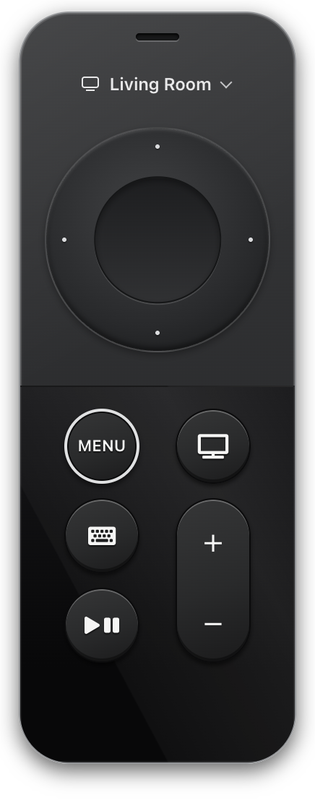

# ATV Desktop Remote

I wanted to control my Apple TV from my Mac, so I forked [Brian Harper’s remote](https://github.com/bsharper/atv-desktop-remote) and gave it a clickpad that feels more like the real thing.



## Run it

You’ll need macOS 13 or later, Node.js 24, and an Apple TV on the same local network. I use it on an Apple Silicon Mac running Sequoia.

```sh
git clone https://github.com/isabellereks/atv-desktop-remote.git
cd atv-desktop-remote
npm ci --legacy-peer-deps
npm ci --prefix app --legacy-peer-deps
npm start
```

Click the remote icon in your menu bar, pick your Apple TV, and enter the PIN shown on the TV. If macOS asks for Local Network access, allow it so the remote can find your TV.

Swipe or click on the pad to move around. Drag the top grip to put the remote where you want it. Hold **Option** to see the keyboard controls, or press **⌃⌘R** to open and close the remote.

The remote talks to your Apple TV over your local network. Pairings are encrypted on your Mac with a key stored in Keychain.

## Credits

Brian Harper’s [atv-js](https://github.com/bsharper/atvjs) handles discovery and remote commands. I borrowed some layout ideas from [Itsytv](https://itsytv.app/en). The [original MIT license](LICENSE) is included.
